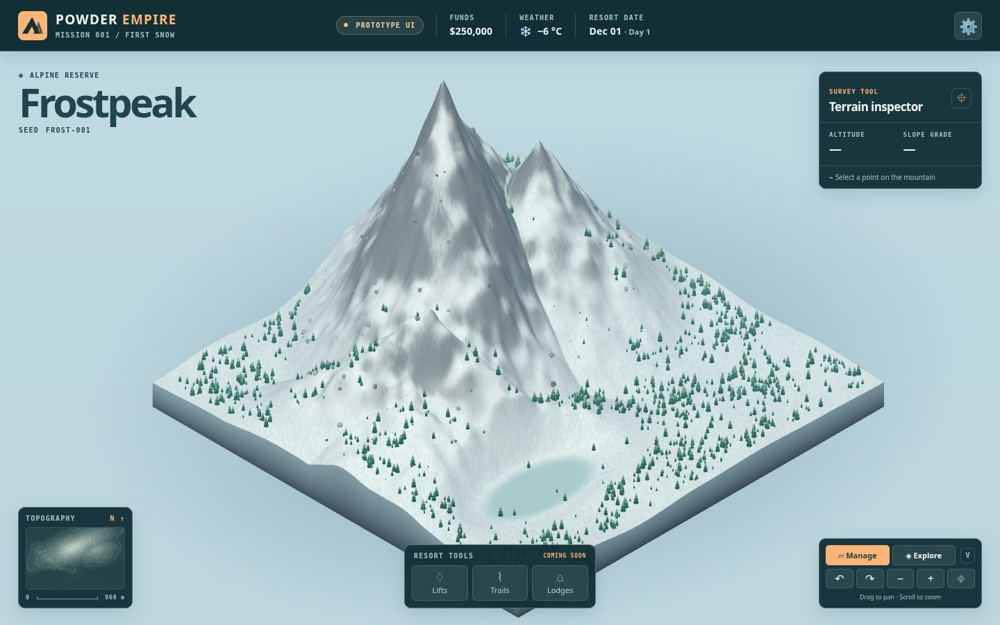
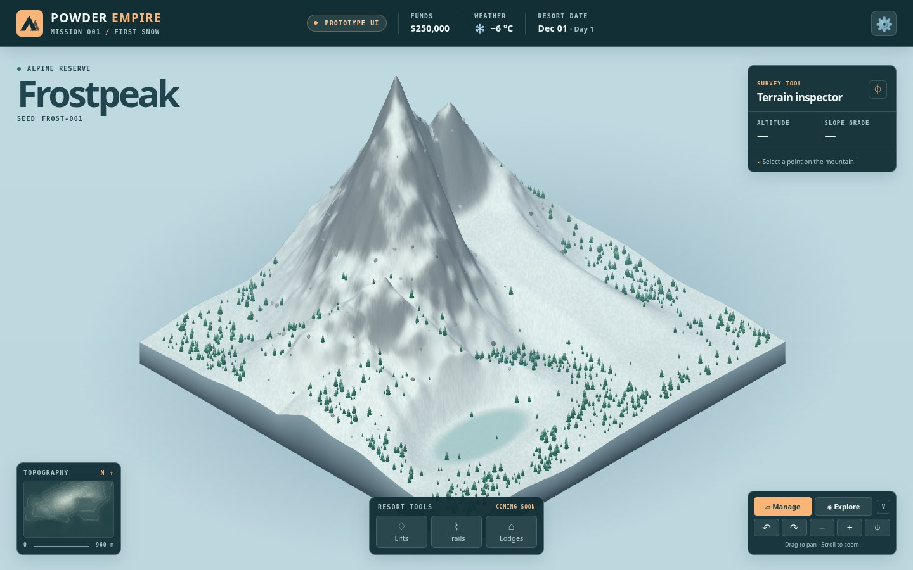

# Mission 001.5 · Mountain Refinement

The eastern face connects two surveyed benches across 468 m of north–south terrain. Frostpeak retains its two high summits, rock walls, forest, and basin. On the default seed, the core of the open face between the benches has approximately 38,000 m² in the intermediate grade band and 8,000 m² in the beginner band, estimated on a 5 m sampling grid. The broad center descends continuously, with the outer shoulders and surrounding terrain providing more variety.

| Frostpeak candidate | World position | Altitude | Footprint radius | Maximum sampled grade |
| --- | --- | ---: | ---: | ---: |
| Base lodge or lower terminal | X 254 m, Z 333 m | 1,272 m | 28 m | 4.6% |
| Upper lift station | X 173 m, Z −135 m | 1,400 m | 21 m | 3.6% |

The candidates are available as `heightmap.sites`. `classifyGrade()` returns beginner (up to 25%), intermediate (up to 40%), advanced (up to 70%), or extreme (above 70%). These prototype terrain bands describe individual samples. Future trail ratings will need to consider the entire route, usable width, and hazards.

Explore uses the same orbit, zoom, and pan controls. Zooming in lowers the orbit target, and dragging upward can pitch the view up to 60°. Terrain clearance raises the eye independently of its viewing direction. Management retains its orthographic controls and starts slightly farther back, with the base and forest visible. Touch devices show the gesture instructions in the camera HUD.

Existing stored seed strings still load. Mission 001.5 generates the revised terrain for those seeds. Settings stay local to the site origin, so a separately hosted preview starts with its own saved settings.

## Before and after

| Mission 001 | Mission 001.5 |
| --- | --- |
|  |  |

- [Broad east face from the southeast](mission-001-5/skiable-face.jpg)
- [Base lodge and lower terminal candidate selected](mission-001-5/base-bench.jpg)
- [Explore looking up toward the summits from near ground level](mission-001-5/ground-upward.jpg)
- [Mobile-sized management layout with tap inspection](mission-001-5/mobile.jpg)

## Verification

- `npm test` passes 12 tests. Coverage includes deterministic heightmaps and station metadata, continuous skiable width and elevation, grade boundaries and interpolation, ground clearance and pitch limits, camera mode switching, and settings round trips. The terrain regression includes five seeds, including `SNOW-JG70AC` from the original iPhone playtest.
- `npm run build` passes. The production HTML, JavaScript, CSS, and favicon load from a Pages-style subpath.
- Desktop and mobile-emulated Chromium with software WebGL passed browser checks for mode switching, navigation, terrain inspection, seed regeneration, persistence, and touch input. Screenshots were inspected. The browser smoke pass reported no console errors or missing resources.

## iPhone Safari approval checklist

1. Open the preview and check that the first Management view shows the summit, base, and forest. Rotate once to the southeast and tap the open face, then the flatter area below it.
2. Switch to Explore. Pan with two fingers toward the bottom of the eastern face, pinch to zoom in, then drag upward. Confirm the view can look uphill while the foreground stays above the snow.
3. Orbit sideways and try a short pan near a steep wall. Check that the camera stays above the terrain and that the reset button returns to the overview.
4. Enter `SNOW-JG70AC` in Settings. Reload, confirm the seed is retained, then repeat the uphill view. Confirm the touch hint mentions two-finger pan and pinch zoom.

Physical iPhone Safari was not available for automation. Within the prototype the camera clears the terrain mesh, and scenery props can still intersect the view at close range. The terrain remains a single 256 × 256 grid with instanced vegetation and rocks. Vite continues to report the existing bundle-size advisory.
