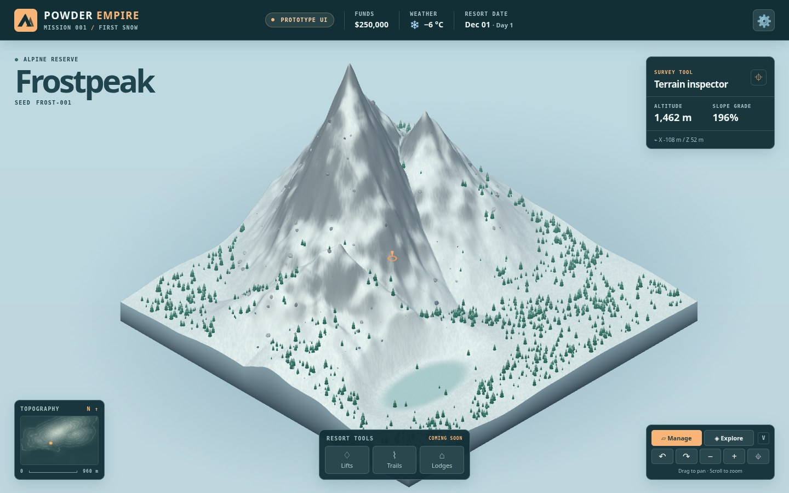
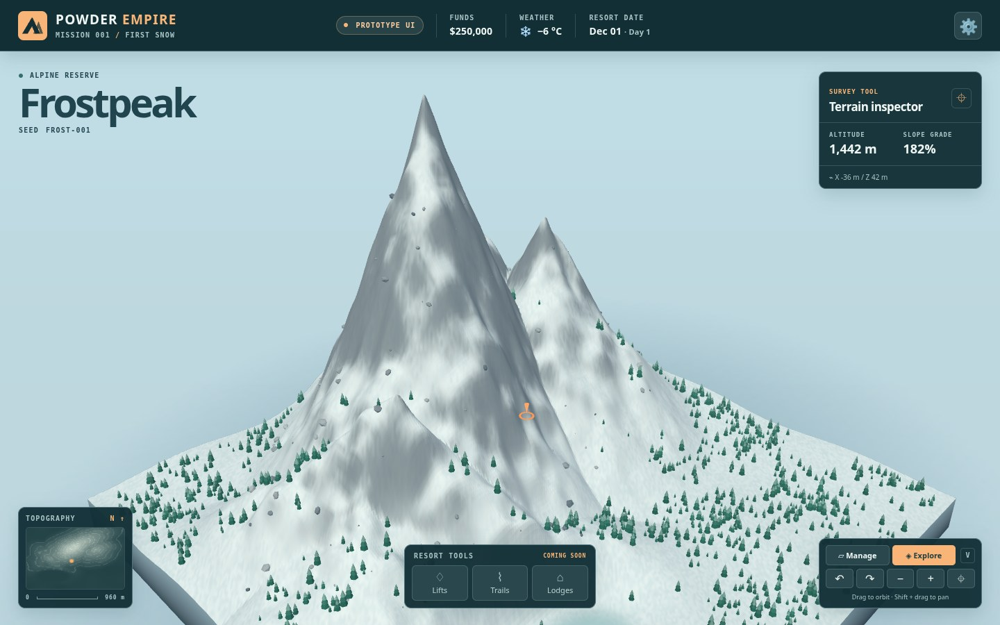
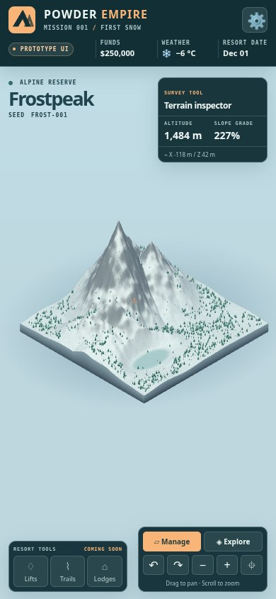

# Mission 001 · First Snow

**18 November 2026**

Frostpeak is a 960 × 960 m procedural alpine reserve with a 256 × 256 heightmap, a seeded summit and ridgelines, a flatter base basin, and slopes of varying grades. The player can survey the reserve from an orthographic management camera or orbit it in perspective explore mode. Selecting the surface displays altitude, slope grade, and world coordinates.

## Verification

| Check | Result |
| --- | --- |
| Clean dependency install, TypeScript check, and production build | Passed with Node.js 24 and Vite 8 |
| Terrain tests | 3 passed. Identical seeds reproduced all 65,536 samples, a different seed changed the heightmap, and the default terrain met summit, base, slope, and triangle-sampling checks. |
| Chromium desktop at 1440 × 900 | Passed. Verified management drag-pan, wheel zoom, quarter-turn and reset, the V shortcut and mode buttons, explore orbit and pan, and terrain readings in both views. |
| Chromium mobile emulation at 390 × 844 | Passed. Verified tap inspection, mode selection, visible HUD controls, and an overflow-free layout. |
| Persistence and regeneration | Passed. A custom seed, low quality, hidden conifers, and reduced motion survived reload. Re-entering the original seed reproduced the same topography, and randomization produced a different one. |
| Production assets under `/powder-empire/` | Passed locally. The browser smoke test reported zero console errors, failed requests, or HTTP errors. The Pages workflow verification script also fetched the expected HTML, script, stylesheet, and favicon from the local subpath. |
| Public GitHub Pages | Source is on the public repository’s main branch. The workflow verifies the live URL and required assets after deployment. See the repository’s Actions tab for the current deployment status. |

## Screenshots

Desktop and mobile captures use the production build and the default `FROST-001` seed.

## Known limitations

- Lifts, trail construction, lodges, skiers, an economy, weather simulation, and terrain editing are outside this mission. The HUD marks resort status as prototype data and disables construction tools.
- The renderer requires WebGL 2. Browser verification used Chromium with software WebGL and mobile emulation. Physical mobile devices and other browser engines remain unverified.
- Vite reports a size advisory for the single Three.js application bundle. The production JavaScript is approximately 564 kB minified and 144 kB gzipped.
